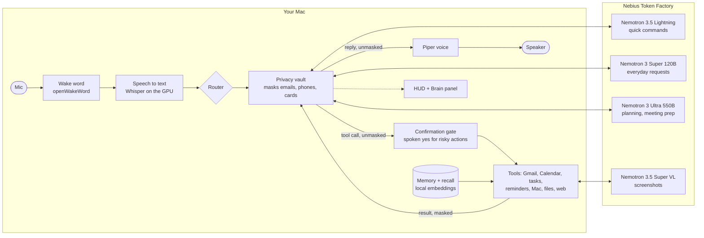

# Architecture

```
                        ┌─────────────────────────────────────────────┐
 mic ──► wake.py        │  assistant.py — the brain                   │
        (openWakeWord,  │                                             │
         always local)  │  claude-sonnet-5-5 on your Claude plan      │
            │ wake word │  (Claude Agent SDK; or the Anthropic API    │
            ▼           │   with LLM_BACKEND=api)                     │
        recorder.py     │                                             │
        (turns.py: VAD  │  system prompt = config/*.md  +  memory/*.md│
         + semantic EoT)│  loaded fresh each session, prompt-cached   │
            │ int16 PCM │                                             │
            ▼           │        ┌── tool loop ──────────────┐        │
        stt.py ────────►│ text ─►│ tools/__init__.py dispatch │       │
        (Whisper turbo  │        │  + CONFIRMATION GATE       │       │
         on the GPU, or │        └──────────┬────────────────┘        │
         CPU / OpenAI)  └───────────────────┼─────────────────────────┘
                                            │
            ┌────────────┬──────────┬───────┴────┬────────────┬───────────┐
            ▼            ▼          ▼            ▼            ▼           ▼
         gmail.py     gcal.py   tasks.py   reminders.py  websearch.py memory.py
         (Gmail API)  (GCal API)(SQLite)   (SQLite +     (DuckDuckGo) (markdown
                                            bg thread)                 files)
                                            │ due → spoken notification
        tts.py ◄── reply text               ▼
        (piper local / elevenlabs / openai) speaker
```

Three front-ends drive the same brain: `voice.py` (wake word → record →
transcribe → chat → speak → follow-up window), `text.py` (a REPL), and
`web.py` + `frontend/` (the HUD, below).
`assistant.py` and everything below it is audio-free, which is what makes
the text mode and the offline test suite possible.

## The HUD (`web.py` + `frontend/`)

```
 browser (React + Three.js)                     web.py (FastAPI, 127.0.0.1)
 ─────────────────────────                      ───────────────────────────
 mic → AudioWorklet → 16 kHz int16 ──binary──►  VoicePipeline (mic owner only)
                                    /ws          sleep:  openWakeWord
                                                 record: TurnDetector + live
                                                         Whisper checks
                                                 watch:  over-talk while speaking,
                                                         additions while thinking
                                                 → Hub.submit()
 reactor / panels / live transcript ◄─JSON──    Hub: state, hearing, transcript,
 queues sentence audio, reports                      tool, reply/say + audio
   ──playback_done(id)──►                            segments, filler, card, hud,
 cards / palette / settings ◄─settings──             settings, confirm, notify
 panels ◄──────── REST /api/* ───────────────
```

- The server owns the state machine (`idle → listening → thinking →
  speaking`, plus `confirm`); the browser renders it. Speech detection is
  streaming Silero (its recurrent state carried across 32 ms frames).
  While Saathi speaks, the pipeline watches for the user talking over it,
  in two stages, following LiveKit's false-interruption handling. When 3
  of 5 chunks score as speech, it captures a "probe" turn (with pre-roll)
  and sends `duck`, and the browser lowers playback to ~20%. After ~640 ms
  of actual speech (or at the first pause, for a short burst), Whisper
  checks the words with `turns.interruption()`. "Stop", "wait", "no" and
  similar always interrupt. Backchannels ("mm-hmm"), Whisper's silence
  hallucinations, a lone word, and Saathi's own echo (word overlap with
  what it's saying) send `unduck`. Anything else sends `barge_in`, and the
  probe carries on as the next turn, with the model told it was cut off.
  While Saathi thinks, the same watcher queues what the user says as an
  addition: the turn answers it next, showing (not speaking) the
  superseded reply. If the reply starts mid-addition, the capture carries
  over as over-talk. After a spoken reply the browser reports playback
  finished (by utterance id) and the server opens the follow-up window
  (20 s, or 6 s with "brief" conversations). If the user signs off
  ("that's all"), it goes back to sleep instead.
- The browser captures the mic in its own 16 kHz AudioContext, so the
  browser resamples (with filtering) before the worklet. It restarts
  capture when the device disappears or the default device changes.
- `tools/media.py` keeps one `media-control stream` process running and
  pushes `{"type": "media"}` to every window whenever the track, play
  state or position changes. Artwork is served from `/api/media/art`. This
  covers any app using the macOS media session, YouTube Music's Chrome app
  included.
- Tools can return a `ToolImage` (a str with base64 image data), which
  both backends pass to Claude as an image block. `screen_look` uses this.
- Replies are synthesized sentence by sentence (first sentence alone,
  then the rest), so speech starts after one sentence of TTS. Audio and
  "one moment" fillers go only to the window that owns the mic, so with
  the app and a browser tab open Saathi speaks once.
- Settings (`settings.py`, persisted to `data/settings.json`) live on the
  server: mood, voice, patience, wake sensitivity, conversation length,
  barge-in, fillers, theme. The HUD and the
  model's tools (`voice_*`, `assistant_set_preference`) both change them,
  and every window is told. `moods.py` maps each mood to a Piper voice,
  pace and volume, plus a style note prefixed to each user message.
- Tools reach the HUD through `hud_bridge.py` (`hud_show_card`,
  `hud_control`) without importing the web server; with no HUD open they
  say so and the model answers aloud instead.
- The confirmation gate is unchanged: `Hub.web_confirm` blocks the turn
  until the user answers by voice, typing, or the on-screen buttons.
- Panel deletes (tasks, reminders, memories) are direct user clicks behind
  their own "are you sure", so those REST endpoints pass `_confirmed=True`;
  the model never reaches them.
- Reminders and timers are announced in the HUD and spoken when Saathi is
  free. Conversation turns are logged to the `conversation` table.

## Turn-taking (`audio/turns.py`)

Modelled on how ChatGPT's voice mode avoids cutting people off (OpenAI's
documented "semantic VAD"): silence alone doesn't end a turn, meaning does.

1. Silero VAD (bundled with faster-whisper) scores every 80 ms chunk;
   speech starts after two chunks ≥ 0.5 (or one ≥ 0.85) and 320 ms of
   pre-roll is kept so the first syllable isn't clipped.
2. At the first pause of `base` seconds the audio so far is transcribed
   and `judge()` classifies it: **complete** (end after `base` of silence),
   **incomplete** (a dangling "and/the/to…", a trailing comma, a lone word:
   wait up to `limit`), or **hold** ("hold on", "let me think", "um":
   wait up to 15 s). Speaking again clears the verdict.
3. When the turn ends after a complete verdict, that transcript is reused,
   so there's no second Whisper pass.

| Patience | base | limit |
|---|---|---|
| snappy | 0.45 s | 2 s |
| balanced (default) | 0.7 s | 4 s |
| patient | 1.0 s | 8 s |

Confirmation answers always use snappy. Voice mode (`voice.py`) uses the
same detector through `recorder.record_utterance`.

## The Mac app (`desktop/`)

An Electron shell around the same HUD: `server.js` starts
`.venv/bin/python -m saathi web` unless a server already answers (and
only ever stops one it started, restarting it on crashes); `main.js` owns
one transparent window that switches between the full HUD and a floating,
always-on-top orb, the menu-bar icon, launch-at-login, and the global
shortcuts (⌘J summon/listen, ⌘⇧J orb/full). When the window loses focus
in full layout (a 300 ms debounce, and not during startup) it collapses to
the orb; coming back through the Dock, the menu or ⌘Tab expands it again,
but only if the orb was collapsed automatically. A tray checkbox turns it off. `preload.js` exposes four
calls to the page as `window.saathiDesktop`; the page needs no other
privileges. The microphone is granted only to the local server's origin.

## Components

| Piece | File(s) | Notes |
|---|---|---|
| Config | `saathi/config.py`, `.env` | All keys, paths, and timings. Nothing sensitive in code. |
| Wake word | `audio/wake.py` | openWakeWord with a custom-trained `models/hey_saathi.onnx`, ONNX runtime, 80 ms frames at 16 kHz. Runs continuously; nothing is recorded or sent anywhere until it fires. |
| Turn-taking | `audio/turns.py`, `audio/recorder.py` | Silero VAD + transcript-based end-of-turn (see above). |
| STT | `audio/stt.py` | Whisper large-v3-turbo on the Apple GPU via `mlx-whisper` (default on Apple Silicon), `faster-whisper` on the CPU elsewhere, or the OpenAI Whisper API (`STT_PROVIDER=openai`). `STT_VOCABULARY` primes it with names to expect. |
| Brain | `saathi/assistant.py` | Multi-turn conversation, manual tool loop, prompt caching (`cache_control` on the system block), refusal handling with server-side model fallback. |
| Tools | `saathi/tools/*` | Schemas + dispatcher in `tools/__init__.py`; one module per capability. |
| TTS | `audio/tts.py` | Piper in-process (voices cached, ~50 ms per sentence once loaded; speed/volume from the mood), ElevenLabs, or OpenAI — selected by `TTS_PROVIDER`. |
| Settings, moods | `settings.py`, `moods.py`, `tools/persona.py` | Server-side settings shared by every window and changeable by voice. |
| HUD tools | `hud_bridge.py`, `tools/hud.py` | Cards and interface actions pushed to open HUD windows. |
| Reminders | `tools/reminders.py` | SQLite table + daemon thread; due reminders are spoken (voice mode) or printed (text mode). |
| Mac control | `tools/mac.py` | osascript with all user/model strings passed as argv (never spliced into script source); arbitrary AppleScript and quitting apps are confirmation-gated. |
| Files | `tools/files.py` | Spotlight search, read (text/PDF) and open, confined to `FILES_ROOTS`. |
| Weather, news, pages | `tools/weather.py`, `tools/websearch.py` | Open-Meteo (no key), DuckDuckGo news, readable-text page fetch. |
| Timers, briefing, vitals | `tools/timers.py`, `tools/briefing.py`, `tools/system.py` | In-memory timers; one-call daily briefing; psutil vitals for gauges. |
| Memory | `tools/memory.py` | One markdown file per fact in `memory/`, first line is the summary. Memories are appended to the system prompt at session start while they fit in `MEMORY_PRELOAD_CHARS`; past that, only a name: summary index goes in. The model writes new ones through `memory_save`. |
| Semantic recall | `embeddings.py`, `tools/recall.py` | The `recall` tool searches memories and past exchanges by meaning. Local `fastembed` (`BAAI/bge-small-en-v1.5`, 384 dims, CPU), vectors stored as normalized float32 BLOBs in the `embeddings` table of `saathi.db`, search is one numpy matrix product. Nothing leaves the Mac. The index is derived data: memory files and the `conversation` table stay the source of truth, and `recall.warm()` rebuilds or catches it up in the background at startup. Turns are embedded on a worker thread so logging never waits. Read-only, so it needs no confirmation; results are framed as reference data, not instructions, and capped at ~1,200 characters. Without `fastembed` it falls back to keyword search. |

## The confirmation gate (enforced in code, not in the prompt)

The system prompt *tells* the model that sending email, editing shared
meetings, and deleting things need approval — but prompts are suggestions.
The enforcement lives in `saathi/tools/__init__.py`:

1. Dangerous handlers (e.g. `gmail.send_draft`, `gcal.delete_event`,
   `tasks.delete`) take a keyword-only-by-convention `_confirmed=False`
   parameter and raise `ConfirmationRequired(prompt)` unless it's `True`.
   For calendar updates the check is dynamic: it only trips when the event
   actually has other attendees.
2. The dispatcher catches the exception, asks the **user** via a `confirm`
   callback — spoken question + yes/no answer in voice mode, keyboard
   prompt in text mode — and only re-invokes the handler with
   `_confirmed=True` if the user approved *in that same turn*. The flag is
   never persisted; the next dangerous call starts from zero.
3. The model cannot self-approve: every model-supplied argument starting
   with `_` is stripped before dispatch, so a tool call like
   `{"draft_id": "d1", "_confirmed": true}` still triggers the question.
   `tests/smoke_test.py` proves exactly this scenario end-to-end.

If the user declines, the tool returns a "user declined, do not retry"
result to the model, which reports back and moves on.

## Three LLM backends

With `LLM_BACKEND=nebius`:




`LLM_BACKEND` in `.env` selects how the brain reaches Claude. Both use
`LLM_MODEL`, default `claude-sonnet-5-5`.

- **`agent-sdk`** (default) — `saathi/agent_backend.py` drives the Claude Code CLI
  through the Claude Agent SDK, authenticating with the user's Claude
  subscription login (no API credits). Saathi's tools are registered as
  an in-process MCP server; every call still flows through
  `tools.execute`, so the confirmation gate applies unchanged. Claude
  Code's own built-in tools (Bash, file access, web) are explicitly
  disallowed. The SDK is async, so the backend runs a private event loop
  on a daemon thread behind the same synchronous `chat()` interface.
- **`api`** — the original path in `assistant.py`: the Anthropic SDK,
  pay-per-token with an API key, with the notes below.
- **`nebius`** — `saathi/nebius_backend.py`: NVIDIA Nemotron on Nebius
  Token Factory through its OpenAI-compatible API. A manual tool loop:
  Saathi's schemas become OpenAI function tools, each call goes through
  `tools.execute` (same gate), and `<think>` blocks are stripped before
  anything is spoken. The chat models are text-only, so a `ToolImage`
  (a screenshot) is put into words by `NEBIUS_VISION_MODEL` first. A
  failed request rolls the turn out of history so the session stays
  valid. `NEBIUS_SYSTEM_PREFIX` (default `/no_think`) keeps Nemotron's
  reasoning off for snappy voice replies.
  - **Routing** (`router.py`): unless a model is pinned in settings, each
    turn goes to `NEBIUS_FAST_MODEL` (short commands: timers, media,
    "add…"), `NEBIUS_DEEP_MODEL` ("plan", "compare", "prep me", or 60+
    words) or `LLM_MODEL`. Rules, not a classifier call: zero added
    latency and an exact reason for the HUD. If a fast/deep model fails
    before any tool has run, the turn is retried on the main model; once a
    tool has run it isn't, so side effects never repeat.
  - **Privacy** (`privacy.py`): emails, phone numbers and Luhn-valid card
    numbers in the system prompt (memories), user text and tool results
    are replaced with stable placeholders (`[EMAIL_1]`) before a request
    is sent. Tool arguments are unmasked just before `tools.execute`, and
    the reply before it's spoken. The map lives in memory for the session
    only. The system prompt also tells the model that tool results are
    data, never instructions (prompt-injection hygiene for email and web
    content).
  - **Telemetry**: each turn's route, model, timings, token counts and
    masked-value count go to the HUD's Brain panel (`{"type": "brain"}`)
    and to text mode.

## Anthropic API usage notes (`LLM_BACKEND=api`)

- Model `claude-sonnet-5-5` (`LLM_MODEL`); thinking is adaptive, and its
  depth is tuned with `output_config.effort` (default `low` for snappy
  voice replies — configurable).
- `betas=["server-side-fallback-2026-07-01"]` + `fallbacks="default"`: if
  a safety classifier declines a benign request, the same call is served
  by the fallback model Anthropic recommends for that kind of decline
  instead of failing. If the whole chain declines, the turn is dropped
  from history and Saathi says so.
- The system prompt (personality + memories) is byte-stable for the whole
  session and marked with `cache_control: ephemeral`, so repeated turns
  read it from the prompt cache. The current timestamp is injected into
  each *user* message instead of the system prompt for the same reason.

## Data on disk

```
.env                  secrets and settings (git-ignored)
config/…prompt.md     editable personality + permission tiers
memory/*.md           one fact per file (git-ignored)
data/saathi.db        tasks, reminders, history, recall vectors (SQLite, git-ignored)
~/.cache/saathi/models  embedding model, ~64 MB (outside the project, so iCloud never syncs it)
data/google_token.json OAuth refresh token (git-ignored)
data/voices/*.onnx    Piper voice models
```
