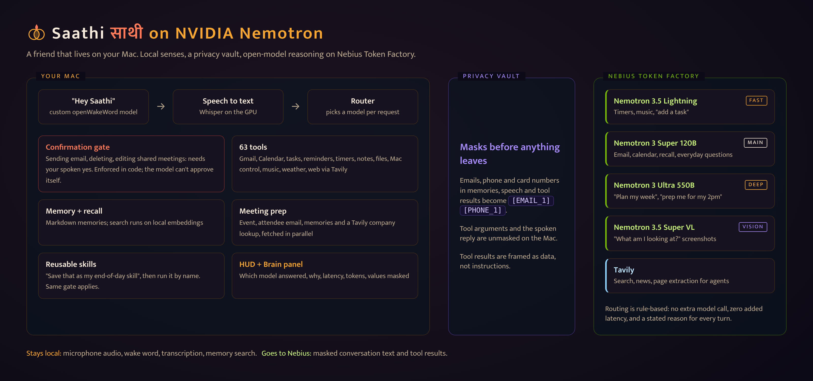

# Saathi

**साथी: a friend that lives on your Mac.** Saathi (Nepali for friend or
companion) is a private voice assistant. Say "Hey Saathi" and ask: it reads
and drafts your email, runs your calendar, keeps tasks, reminders and
timers, controls music and apps, searches files and the web, reads your
screen, remembers what matters, and learns your routines as reusable skills.
It thinks with NVIDIA Nemotron open models on Nebius Token Factory.

Built by Yogesh Dhakal for the Nebius x NVIDIA Global AI Hackathon
(Personal AI track). MIT licensed.



## What makes it personal, and private

- **Local senses.** The wake word, speech recognition (Whisper on the Mac's
  GPU) and memory search run on the Mac. No audio leaves the machine.
  openWakeWord has no "Hey Saathi" model, so by default Saathi transcribes
  short bursts of idle speech locally and wakes on its name; a trained model
  is used instead when present (`docs/wake-word.md`).
- **A privacy vault.** Email addresses, phone numbers and card numbers are
  replaced with placeholders like `[EMAIL_1]` in everything sent to Nebius:
  your saved memories, what you say, and tool results such as emails. Real
  values are restored on the Mac just before a tool runs and before Saathi
  speaks.
- **A confirmation gate in code.** Sending email or texts, deleting
  anything, or editing a meeting with other attendees needs your spoken yes
  in the same turn. Any argument the model passes that starts with an
  underscore is stripped, so it can't approve itself. A test proves it.
- **Persistent memory.** One Markdown file per fact, searched by meaning
  with local embeddings.
- **Reusable skills.** Do something once, then say "save that as my
  end-of-day skill". Saathi stores the steps and the tool calls it made, and
  "run my end-of-day skill" does it again, through the same confirmation
  gate. Three starter skills ship in `skills/`.
- **A calm home screen.** A greeting, your next meeting, open tasks and the
  weather, quick-action chips, a shelf of your saved skills (plain Markdown
  files, or Agent Skills style `name/SKILL.md` folders) and a one-tap model
  switch (Auto, Lightning, Super, Ultra). It steps aside while you talk and
  replies fade on their own. Set `USER_NAME` in `.env` for the greeting.

## How it uses Nemotron, Token Factory and Tavily

- **Three Nemotron sizes, routed per request.** Quick commands ("pause the
  music") go to Nemotron 3.5 Lightning, everyday requests to Nemotron 3
  Super 120B, and planning or "prep me" requests to Nemotron 3 Ultra 550B.
  The router is rule-based, so it adds no latency, and the Brain panel shows
  which model answered and why. If Lightning or Ultra fails before a tool
  has run, the turn retries on Super.
- **Vision.** Nemotron 3.5 Super VL describes a screenshot for the text
  model when you ask "what am I looking at?".
- **Tool calling** for all 63 tools through Token Factory's
  OpenAI-compatible API (`saathi/nebius_backend.py`).
- **Tavily** powers web search (ranked results plus a short answer), news,
  page reading (Tavily Extract) and the company lookup in meeting prep, with
  DuckDuckGo as a fallback.
- **Meeting prep.** "Prep me for my 2pm" finds the meeting, then fetches
  recent email with each attendee, what Saathi remembers about them and a
  Tavily look at their organisation in parallel. Nemotron Ultra turns it
  into an on-screen briefing card and a short spoken summary.

## Quick start

```bash
git clone https://github.com/Yogesh1533/saathi && cd saathi
python3 -m venv .venv && source .venv/bin/activate
pip install -r requirements.txt
cp .env.example .env        # add NEBIUS_API_KEY, and TAVILY_API_KEY if you have one
python -m saathi nebius-models --probe     # check which Nemotron models your key can use
python -m saathi text                      # type to Saathi in the terminal
cd frontend && npm install && npm run build && cd ..
python -m saathi web                       # the full interface at http://127.0.0.1:8765
```

Gmail and Calendar need a one-time Google sign-in (section 5). Say "Hey
Saathi", or press Space or tap the orb to talk. Details follow.

### For judges: test it in about three minutes

You need Python 3.10+, a Nebius Token Factory API key (the Builder Program
credits work) and Node 18+ only if you want the full interface. A Tavily key
is optional; web search falls back to DuckDuckGo without one. No Google
sign-in is needed for the checks below.

```bash
git clone https://github.com/Yogesh1533/saathi && cd saathi
python3 -m venv .venv && source .venv/bin/activate
pip install -r requirements.txt
cp .env.example .env     # set NEBIUS_API_KEY (and TAVILY_API_KEY if you have one)
python -m saathi text    # type to Saathi in the terminal
```

Things to try: "set a ten minute timer for the dal" (Lightning), "add a task
to call 0412 345 678" (the phone number is masked on its way to Nebius and
still saved), "search the web for the latest on Nebius Token Factory"
(Tavily), "save that as my demo skill", then "run my demo skill". For the
interface with the Brain panel (which model answered, why, tokens, masked
values), build the frontend as above and run `python -m saathi web`.
`python tests/smoke_test.py` runs the 291 offline checks and needs no key.
Meeting prep, Gmail and Calendar need the one-time Google sign-in; Mac
control tools (music, apps) need macOS.

---

## 1. Requirements

- macOS or Windows laptop with a microphone (Raspberry Pi works too, but
  use a small Whisper model).
- Python 3.10+ (3.12 recommended)
  (tip: `uv venv --python 3.12 .venv` gets you a modern Python without
  touching the system one).
- Claude access: either a Claude subscription (Pro/Max) or an Anthropic
  API key with credits (see step 3). Everything else is free.

## 2. Install

```bash
cd saathi
python3 -m venv .venv
source .venv/bin/activate        # Windows: .venv\Scripts\activate
pip install -r requirements.txt
cp .env.example .env
```

Open `.env` in any editor. The next sections tell you what to put in it.

## 3. The brain: Nemotron on Nebius (default), or Claude

**Default: NVIDIA Nemotron on Nebius Token Factory.** Create a key in the
[Token Factory](https://tokenfactory.nebius.com) console and put it in
`.env` as `NEBIUS_API_KEY=...` (`LLM_BACKEND=nebius` is the default). Check
which NVIDIA models your key can use and that they return tool calls:

```bash
python -m saathi nebius-models --probe
```

The defaults are `nvidia/nemotron-3-super-120b-a12b` (main),
`nvidia/Nemotron-3_5-Lightning` (fast), `nvidia/Nemotron-3-Ultra-550b-a55b`
(deep) and `nvidia/Nemotron-3.5-Super-VL` (vision); change them with the
`NEBIUS_*` lines in `.env`. Settings → Model offers Automatic routing or a
fixed model.

**Optional: Claude.** `LLM_BACKEND=agent-sdk` uses a Claude Pro or Max login
through the Claude Code CLI; `LLM_BACKEND=api` uses an Anthropic API key
(`ANTHROPIC_API_KEY`). The tools, memory, skills and confirmation gate work
the same on every backend; routing, the privacy vault and the Brain panel are
Nebius features.

## 4. First run: text mode (no audio needed)

```bash
python -m saathi text
```

Type instead of talking; everything else (tools, memory, confirmations)
works identically. Try: *"add a task to buy milk tomorrow evening"*, then
*"what's on my task list?"*. Confirmations arrive as a `[CONFIRM] ... [yes/no]:`
prompt. This is the fastest way to test changes to the system prompt or tools.

## 4b. The HUD (recommended)

A full-screen interface over the same brain: an animated
reactor that orbits, spirals and pulses as Saathi listens, thinks and
speaks, with live panels for your agenda, tasks, timers, reminders, inbox,
system vitals and memories.

Build the front-end once (needs Node 18+):

```bash
cd frontend && npm install && npm run build && cd ..
```

Then run it and open <http://127.0.0.1:8765> in Chrome, Edge or Safari:

```bash
python -m saathi web
```

Click **Bring Saathi online** (browsers need one click before a page may
use the mic and speakers) and allow microphone access. From then on:

- Say **"Hey Saathi"**, then your request. The wake word, turn-taking and
  Whisper transcription all run in the Python server on this Mac; the
  browser only streams mic audio to it over localhost.
- **Take your time.** A pause doesn't end your turn: Saathi transcribes
  what you've said so far and, if it sounds unfinished ("turn off the
  lights in the…"), keeps listening; "hold on" or "let me think" buys more
  time. You'll see what it's hearing live, with a bar showing how long it
  will wait. Choose Snappy, Balanced or Patient in settings, or just say
  "give me more time to think".
- **Talk over it** to interrupt, like with a person. When you start
  talking, Saathi turns its voice down at once. If you said real words, it
  stops and listens. If it was just "mm-hmm", "yeah", or its own voice
  leaking into the mic, it carries on. Saying something while it's still
  thinking adds to your request. Replies start speaking after the first
  sentence, and Saathi says a short "one moment" while slow tools run.
- **Conversations stay open**: after a reply, Saathi keeps listening for
  about 20 seconds so you can carry on without the wake word. Say "that's
  all" or "thanks, Saathi" to end early, or choose shorter conversations
  in settings. Settings also has wake word sensitivity and a microphone
  picker with a level meter. Saathi follows headsets and USB mics as they
  come and go.
- **Moods**: Classic, Calm, Focused, Upbeat and Night each have their own
  voice, pace and style. Pick one from the top bar, or say "switch to calm
  mode". You can also pick any installed voice, or let Saathi choose a
  mood from how you sound.
- Press **Space** / tap the reactor to talk without the wake word,
  **Esc** to interrupt, **/** to type, **⌘K** for the command palette
  (moods, voices, themes, settings, or type anything to ask).
- Saathi can put **cards** on screen (lists, numbers, headlines) and
  control the interface by voice: "show my history", "switch to orb mode",
  "clear the cards", "mute the mic".
- Confirmations appear as an on-screen alert and are spoken; answer by
  voice, by typing yes/no, or with the buttons.
- **Now playing** follows whatever is playing on your Mac (YouTube Music,
  including its Chrome app, Spotify, Apple Music or a browser tab) live,
  with artwork, a progress bar you can drag to seek, ±15 s, play/pause,
  skip and volume. It reads macOS's media session through
  [`media-control`](https://github.com/ungive/media-control):
  `brew install media-control`. Without it, only Spotify and Music work.
  Conversation history (clock icon) survives restarts.

## 4c. The Mac app (⌘J from anywhere)

`desktop/` wraps the HUD in a small Electron app: no browser tab, no
"Bring Saathi online" click, and it starts the Python server itself (or
uses one already running).

```bash
cd desktop && npm install && npm run pack
```

That builds `Saathi.app`, installs it into `~/Applications` and signs it
for this Mac. Open it from Spotlight. Then:

- **⌘J** anywhere: Saathi appears and listens (or stops talking).
- **⌘⇧J**: switch between the full interface and a small floating orb
  that stays on top of your other windows without taking focus.
- **Switch to another app** and the full interface shrinks to the orb by
  itself, so Saathi stays in view while you work. Come back through the
  Dock, "Show Saathi" or ⌘Tab and the full interface returns; clicking the
  orb itself doesn't expand it. Turn this off with "Orb when I switch to
  another app" in the menu-bar icon.
- Menu-bar icon: talk, show, orb/full, orb-on-switch, **Launch at login**, server log, quit.
  Closing the window keeps Saathi listening in the menu bar.

The first launch asks for the microphone: allow it. ⌘J
replaces that shortcut in other apps (e.g. Chrome's Downloads) while Saathi
runs. Server logs go to `~/Library/Logs/Saathi/server.log`. For development,
`cd desktop && npm start` runs it without packaging.

Front-end development with hot reload: run `python -m saathi web` and, in
another terminal, `cd frontend && npm run dev`, then open
<http://localhost:5173>.


## 5. Google: Gmail and Calendar (optional but recommended)

One-time setup, roughly 5 minutes:

1. Go to <https://console.cloud.google.com> and create a project (any name).
2. **APIs & Services → Library**: enable the **Gmail API** and the
   **Google Calendar API**.
3. **APIs & Services → OAuth consent screen**: choose **External**, fill in
   the app name and your email, and add **your own Gmail address as a test
   user**. (Test mode is fine forever for personal use.)
4. **APIs & Services → Credentials → Create credentials → OAuth client ID →
   Desktop app**. Download the JSON and save it as `credentials.json` in
   the project folder (or point `GOOGLE_CREDENTIALS_PATH` at it).
5. Run:

   ```bash
   python -m saathi setup-google
   ```

   A browser opens; sign in and approve. The token is stored at
   `data/google_token.json` and refreshes itself from then on.

   If Google says "Access blocked … has not completed the Google
   verification process", your address isn't a test user yet. Add it under
   **Google Auth Platform → Audience → Test users**, then run the command again.

Once connected, Saathi brings things up without being asked (Settings →
Heads-ups, or just say "warn me 10 minutes before meetings"):

- **Meeting alerts**: a spoken heads-up 5 minutes before each event on your
  calendar (5/10/15 minutes, or off). If you haven't touched the Mac in
  10 minutes, it only shows on screen.
- **Morning briefing**: from 7:00 (or a time you choose), the first time you
  sit down at your Mac before noon, Saathi reads you the weather, your first
  meetings and the email that matters. Once a day.

## 6. Voice: pick your TTS

**Piper (default, free, local).** Download a voice once:

```bash
python -m piper.download_voices en_GB-alan-medium --data-dir data/voices
```

Then make sure `PIPER_VOICE` in `.env` points at the downloaded `.onnx`
file. Browse other voices at <https://rhasspy.github.io/piper-samples/>.

**ElevenLabs (best quality).** Create a key at <https://elevenlabs.io>
(Profile → API keys), then in `.env` set `TTS_PROVIDER=elevenlabs` and
`ELEVENLABS_API_KEY=...`. Pick a voice ID from their Voice Library if you
don't want the default.

**OpenAI.** Create a key at <https://platform.openai.com/api-keys>, then set
`TTS_PROVIDER=openai` and `OPENAI_API_KEY=...`.

**Speech to text.** On Apple Silicon Macs, Saathi runs Whisper large-v3-turbo
on the GPU (`mlx-whisper`, in `requirements.txt`; the model downloads once,
about 1.6 GB). On spoken commands with room noise it got 10.5% of words
wrong versus 27% for the old `base.en` default, in about 0.4 s. Other Macs
use `faster-whisper` on the CPU. Put names Saathi should expect (contacts,
artists, places) in `STT_VOCABULARY` in `.env`, comma-separated. For the
OpenAI Whisper API instead, set `STT_PROVIDER=openai` (uses the same
`OPENAI_API_KEY`).

## 7. Run it

```bash
python -m saathi
```

First launch downloads the wake-word and Whisper models (a minute or two).
Then: say **"Hey Saathi"**, wait for the chime, and speak. After it answers
it keeps listening for ~6 seconds so you can follow up without repeating the
wake word. All timings are tunable in `.env`.

macOS will ask for microphone permission for your terminal the first time:
allow it (System Settings → Privacy & Security → Microphone).

Things to try:

- "Good morning" → a spoken briefing: weather, agenda, mail, tasks.
- "Set a ten minute timer for the pasta."
- "What's playing?" / "Skip this song" / "Go back 15 seconds" / "Play Sajjan Raj Vaidya on YouTube Music."
- "What am I looking at?" / "Help me with this error." *(Saathi looks at your screen)*
- "Summarize this page." *(uses the browser tab you're on)*
- "Make a note: ideas for the thesis intro…" / "What did I note about the landlord?"
- "Text Mum that I'm running late." *(asks you to confirm first)*
- "Open Safari and go to the BBC." / "Take a screenshot."
- "Find my resume and summarize it."
- "What's in the news about SpaceX?" / "Read this page: <url>"
- "Run my Good Night shortcut."

- "What's on my calendar this week?"
- "Search my email for anything from the university."
- "Draft a reply saying I'll be there." → "Okay, send it." *(asks you to confirm out loud)*
- "Remind me in 20 minutes to stretch."
- "Remember that my sister's birthday is March 3rd."

## 8. Run on startup (optional)

**macOS**: create `~/Library/LaunchAgents/local.saathi.plist`:

```xml
<?xml version="1.0" encoding="UTF-8"?>
<!DOCTYPE plist PUBLIC "-//Apple//DTD PLIST 1.0//EN"
  "http://www.apple.com/DTDs/PropertyList-1.0.dtd">
<plist version="1.0"><dict>
  <key>Label</key><string>local.saathi</string>
  <key>ProgramArguments</key><array>
    <string>/path/to/saathi/.venv/bin/python</string>
    <string>-m</string><string>saathi</string><string>voice</string>
  </array>
  <key>WorkingDirectory</key><string>/path/to/saathi</string>
  <key>RunAtLoad</key><true/>
  <key>KeepAlive</key><true/>
  <key>StandardOutPath</key><string>/tmp/saathi.log</string>
  <key>StandardErrorPath</key><string>/tmp/saathi.err</string>
</dict></plist>
```

Load it with `launchctl load ~/Library/LaunchAgents/local.saathi.plist`.
Note: launchd-started processes need mic permission granted to the Python
binary; if it can't hear you, run it once from Terminal first.

**Windows**: Task Scheduler → Create Task → trigger *At log on* → action:
`C:\...\saathi\.venv\Scripts\python.exe` with arguments `-m saathi voice`
and *Start in* set to the project folder.

## 8b. Memory recall

Saathi can find things you told it, or discussed, weeks ago by meaning, not
exact words ("what hotel did we pick for Lisbon?"). It uses a small local
embedding model (`fastembed`, about 64 MB, downloaded once to
`~/.cache/saathi/models`); nothing is sent anywhere. The first launch builds
the index in the background, so give it a few seconds. Settings in `.env`:
`RECALL_INDEX_TURNS=0` stops indexing conversations, `RECALL_MIN_SCORE`
tunes how close a match must be, and `MEMORY_PRELOAD_CHARS` caps how much
memory goes into each session's prompt before it switches to an index.
Without `fastembed` installed, recall falls back to keyword search.

You can also switch Claude model (Sonnet, Opus, Haiku) from Settings in the
HUD, or by saying "use Opus" / "back to the default model".

## 9. Tests

```bash
python tests/smoke_test.py
```

Runs offline (fake model, fake Gmail): exercises tasks, reminders, memory,
turn-taking (pausing mid-thought, "let me think", barge-in pre-roll),
moods and voice-controlled settings, HUD cards, web search, and proves the
confirmation gate blocks unconfirmed sends, including a simulated model
that tries to set the confirmation flag itself.

## 9b. Tool-calling eval (Nebius)

```bash
python tests/tool_eval.py --limit 10   # quick check, ~100k tokens
python tests/tool_eval.py              # all 27 requests on auto routing, ~270k tokens
python tests/tool_eval.py --configs auto lightning super ultra   # full comparison, ~1M
```

27 everyday voice requests, each in a fresh conversation with the real
system prompt and every tool offered. Tools are stubbed, so nothing is
actually sent or changed. It scores whether the model picks the right tool
and how fast it decides (one request per case), and writes
`tests/tool_eval_results.md`. It uses real tokens and stops at `--budget`
(default 300k).

## Troubleshooting

| Symptom | Fix |
|---|---|
| Wake word never triggers | Settings → Listening → Wake word: Sensitive (or lower `WAKE_THRESHOLD`); check mic permission. |
| Triggers on random speech | Wake word: Strict (or raise `WAKE_THRESHOLD`). |
| Cuts you off mid-sentence | Say "give me more time to think" (or Settings → Listening → Patient). |
| Saathi interrupts itself | Its own voice is reaching the mic: use headphones, or turn off "Stop talking when I interrupt". |
| Saathi doesn't hear you at all | Settings → Listening: check the microphone picker and that the level meter moves. The top bar says "Waiting for a microphone" when none is connected. |
| Now playing is empty for YouTube Music | `brew install media-control`, then restart Saathi. |
| "What's on my screen" sees only the wallpaper | Allow Saathi under System Settings → Privacy & Security → Screen Recording, then restart it. |
| App stuck on "Starting the Saathi server" | Check `~/Library/Logs/Saathi/server.log`; the Python environment must exist at `.venv`. |
| Saathi mishears names or words | Add them to `STT_VOCABULARY` in `.env` (comma-separated), then restart. |
| Slow transcription | On Apple Silicon, check Settings shows the GPU model (`pip install mlx-whisper`). Elsewhere use `WHISPER_MODEL=tiny.en` or `STT_PROVIDER=openai`. |
| "piper CLI not found" | `pip install piper-tts` inside the venv, and download a voice (step 6). |
| Google tool errors | Re-run `python -m saathi setup-google`. |
| Slow replies | Keep `LLM_EFFORT=low`; raise to `medium`/`high` for harder questions. |
| HUD says "Microphone blocked" | Allow the mic for `127.0.0.1` in the browser's site settings, then toggle the mic button. |
| Mac control asks for permission | macOS asks once per app the first time Saathi controls Music/Spotify etc. (System Settings → Privacy & Security → Automation). Allow it for your terminal/Python. |
| "You've hit your monthly spend limit" | Your Claude plan's usage limit for that model; set `LLM_MODEL` to another model in `.env` or wait for the reset. |
